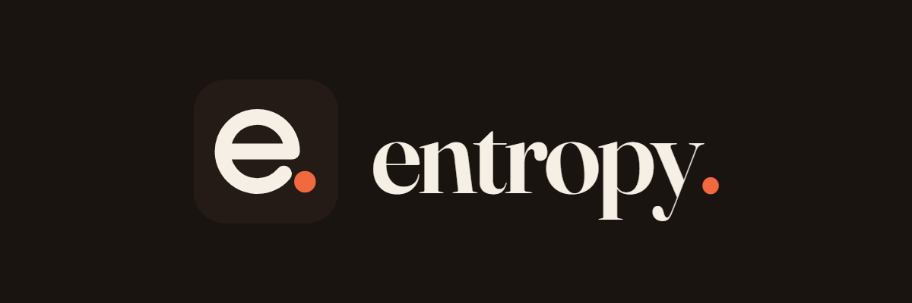
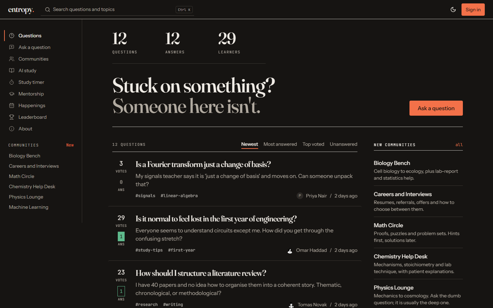
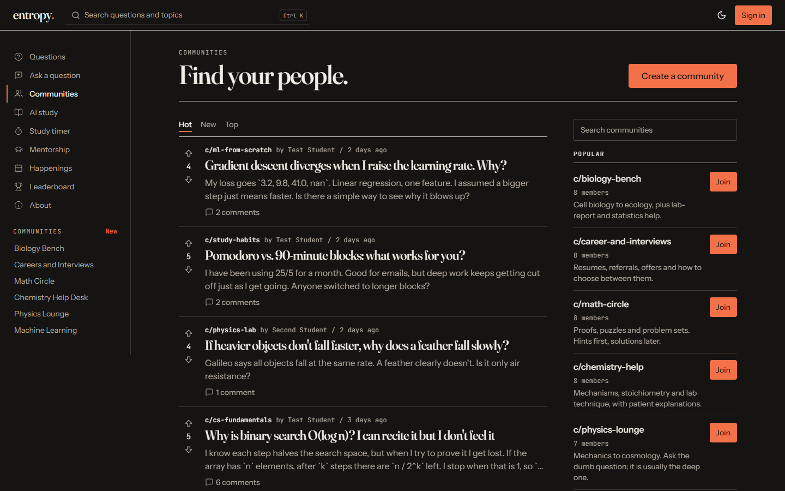
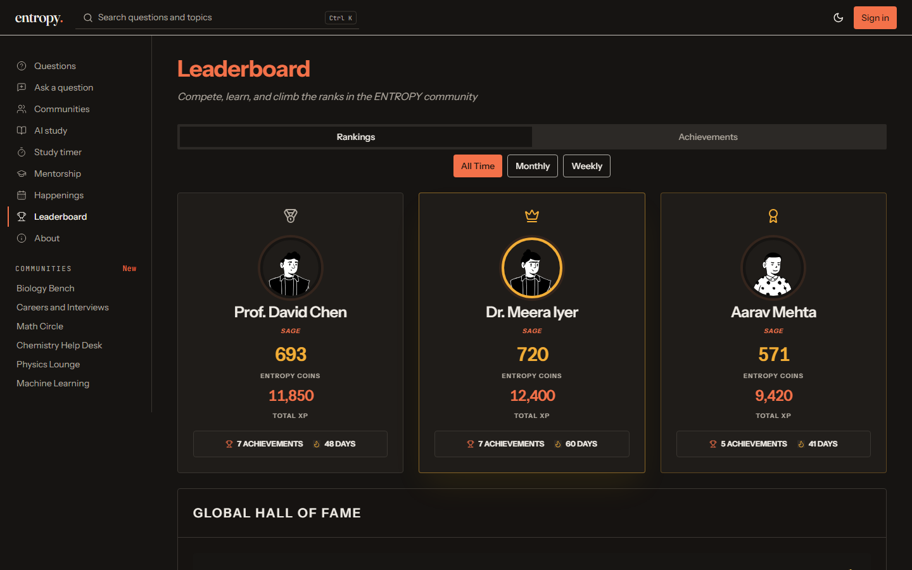

<div align="center">



### A self-learning, context-gathering learning engine.

**Ask anything. Get answers from your own notes, trusted community answers, and the web, from a tutor that remembers what you know.**

[**Live app → entropy-app-psi.vercel.app**](https://entropy-app-psi.vercel.app)




</div>

---

## The problem

Students learn from scattered sources (their own notes and PDFs, forum answers, the web) and get generic AI answers that know nothing about them.

- **Answers ignore the learner.** A chatbot explains photosynthesis the same way to a beginner and an expert, and forgets everything next session.
- **Answers ignore the learner's own material.** Notes, slides, and PDFs sit in a folder, apart from the tool that answers questions.
- **Community knowledge is untrusted and unsearchable.** Good peer answers are buried, and bad ones look the same.
- **Practice is disconnected from explanation.** Quizzes, timers, and revision plans live in other apps and never feed back into what the learner studies next.

## What Entropy does

Entropy answers a learner's questions from **their own resources, trusted community answers, and the web**, remembers what they know, and turns every interaction into practice.

| Capability | What the learner gets |
|---|---|
| **Ask and learn** | Answers with citations from uploaded resources, community answers, and web search |
| **Learner memory** | Concept mastery and focus time per topic are tracked; quiz difficulty and review queues follow mastery |
| **Quizzes, flashcards, assessments** | Generated questions and flashcards, with rubric-based grading and explainable scores |
| **Focus timer** | Pomodoro sessions tied to a topic; focus time per topic is kept in the learner profile |
| **Mind maps** | Concept maps generated from a question or a document |
| **Slides and artifacts** *(milestone 2)* | Generated slide decks and interactive artifacts, rendered in a sandbox |
| **Communities** | Reddit-style communities: join, post, threaded comments, up/down votes, hot/new/top ranking, moderators, and rules. Plus Q&A with accepted answers, reputation, achievements, and leaderboards |

<div align="center">

<br><i>Communities: find your people, vote on what's useful, and join the discussion.</i>
<br><br>

<br><i>Leaderboard: earn XP and Entropy Coins, keep a streak, and climb the ranks.</i>
</div>

---

## How it works

```
Browser -> Next.js (UI, auth, API routes, Prisma)       [Vercel]
              | server-only token + verified user id
              v
          FastAPI AI service (skills, memory, queues)    [Render]
              -> Groq via LangChain (LLM)
              -> fastembed (local embeddings)
              -> Pinecone (vector search)
              -> Neo4j Aura Free (concept graph)
              -> Supabase Postgres + Storage
```

- **Memory.** Four kinds: *working* (the current conversation), *episodic* (conversations, quiz attempts, and study sessions in Postgres), *semantic* (documents in Pinecone, concepts in Neo4j), and *procedural* (the learner profile). Automatic summarising of sessions into the profile is planned.
- **Skills.** Ask/explain, quiz, flashcards, mind map, and study plan. A unified skill registry with an intent router is planned.
- **Queues.** Mastery updates, XP, and memory consolidation run on in-process message queues, with events persisted so a restart does not lose them. There is no SQS or Lambda.
- **Auth.** The browser talks only to Next.js. Next.js verifies the session and calls the AI service with a server-side token.
- **Concept graph.** On first start the AI service seeds about 285 concepts and keeps growing the graph from the questions asked.

## Scope

- **In scope:** the capabilities above, running on free-tier hosting.
- **Out of scope for now:** paid cloud services (AWS Bedrock, RDS, Lambda), native mobile apps, and live video tutoring.

---

## Try the demo

The demo login is password-free and only ever offered when `NEXTAUTH_URL` is `localhost`, so it cannot be enabled on a real deployment. Pick an account on the sign-in page:

| Account | What it is |
|---|---|
| `student@local.dev` | Has joined most communities, has questions and answers |
| `student2@local.dev` | A second learner, for testing interactions |
| `mentor@local.dev` | Admin of CS Fundamentals and ML From Scratch, has a mentor profile |

Any other `name@local.dev` also works and creates a fresh account. The seed adds six communities with threaded discussion, votes, and a few Q&A threads (set `SEED_DEMO=false` on the `migrate` service to skip it).

**The AI tutor** needs only a free Groq key. Document search uses Postgres by default, or Pinecone when `PINECONE_API_KEY` is set. Upload a document in *AI study*, then ask about it, and the answer cites it.

**Sign-in providers.** Google and GitHub are supported (callback `http://localhost:5000/api/auth/callback/<google|github>`). Providers without credentials are simply not shown.

### Tested end to end

A simulation script signs in and plays out the community and AI flows in **68 checks**, with a `--skip-ai` mode that covers community and auth only (no LLM calls).

> Groq's free tier rate-limits (HTTP 429). The tutor then slows down or skips optional steps rather than failing, and repeated simulation runs inside a minute can trigger it.

## Configuration

| Variable | Purpose |
|---|---|
| `DATABASE_URL`, `DIRECT_URL` | Postgres (both the web app and the AI service) |
| `NEO4J_URI` / `NEO4J_USER` / `NEO4J_PASSWORD` | Concept graph (AI service) |
| `AI_BACKEND_TOKEN` | Shared secret between web and AI service; must be identical in both |
| `NEXTAUTH_URL` / `NEXT_PUBLIC_APP_URL` / `NEXTAUTH_SECRET` | Auth and app URL |
| `BACKEND_URL` | Where the web app reaches the AI service |
| `GROQ_API_KEY` | Free key from console.groq.com; without it the tutor returns a clear "not configured" error |
| `PINECONE_API_KEY` | Optional; without it document search runs on Postgres |

Hosting is covered in [DEPLOYMENT.md](DEPLOYMENT.md).

## Status

**Deployable.** The web app builds with type and lint checks on, the AI service ships as a Docker image, and CI runs both. Slides and sandboxed artifacts are next. Requirements are in [`REQUIREMENTS.md`](REQUIREMENTS.md).

## Go deeper

[Architecture](docs/ARCHITECTURE.md) · [AI brain](docs/AI_BRAIN_ARCHITECTURE.md) · [Gamification](docs/GAMIFICATION.md) · [Trust & abuse model](docs/TRUST_AND_ABUSE_MODEL.md) · [Requirements](REQUIREMENTS.md)
